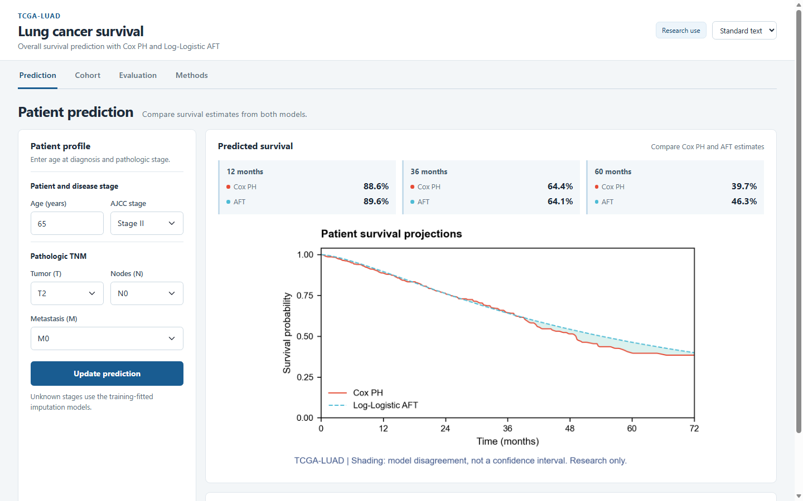
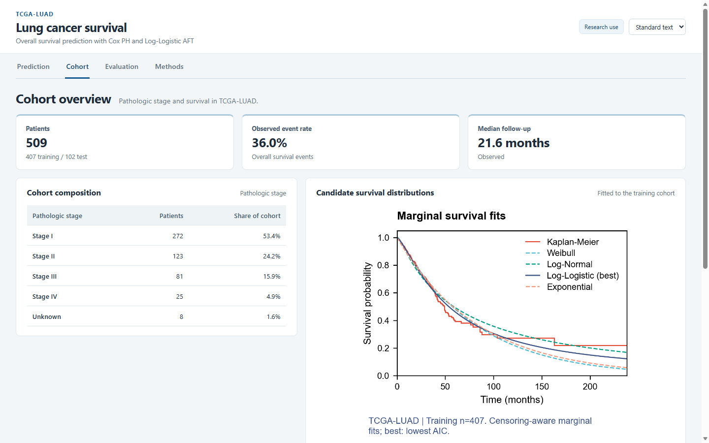

# Lung Cancer Survival Dashboard

A [Shiny for Python](https://shiny.posit.co/py/) application comparing Cox proportional hazards and Log-Logistic accelerated failure time (AFT) models for overall survival in TCGA lung adenocarcinoma.

[Open the live application](https://medictio.shinyapps.io/nsclc-survival/)

Access requires an account. Register with an email address, confirm it through the verification email, then sign in. Passwords are verified by Supabase Auth and are not stored by the app.


> [!WARNING]
> For research and education only. The models have not been externally validated and must not be used for individual prognosis or treatment decisions.

| Patient prediction | Cohort overview |
|---|---|
|  |  |

## Data and models

The [TCGA-LUAD dataset](https://portal.gdc.cancer.gov/projects/TCGA-LUAD) includes 509 patients: 407 in the training split and 102 in the event-stratified test split (seed 42). Overall survival is measured from diagnosis to death or last follow-up; patients alive at last follow-up are censored.

The five inputs are age at diagnosis and pathologic stage, T, N, and M categories. Five training-fitted multiple imputations handle missing predictors. The application compares an L2-regularized Cox model with a Log-Logistic AFT model; the AFT family is selected by training-set AIC. The dashboard also shows cohort summaries, survival estimates, and model evaluation.

## Performance

These figures describe the checked-in bundle. Training results are apparent performance; test results are from the held-out split.

| Model | C-index, train | C-index, test (95% bootstrap CI) | IBS, train | IBS, test | Mean test AUC |
|---|---:|---:|---:|---:|---:|
| Cox PH | 0.669 | 0.696 (0.591–0.766) | 0.1958 | 0.2041 | 0.729 |
| Log-Logistic AFT | 0.676 | 0.686 (0.594–0.755) | 0.1884 | 0.1949 | 0.723 |

The test C-index intervals use 150 bootstrap resamples. IBS and cumulative/dynamic AUC use supported evaluation times from 12 to 60 months. Results from a single split of a retrospective cohort do not establish clinical generalizability. M-stage missingness is substantial; external validation and missing-data sensitivity analyses are needed.

## Run locally

Use Python 3.13 and activate a virtual environment before installing dependencies:

```bash
git clone https://github.com/MUQING-research/lung-cancer-survival-app.git
cd lung-cancer-survival-app
python -m venv .venv
# Activate .venv, then:
python -m pip install -r 04_model_deployment/requirements.txt
shiny run --reload 04_model_deployment/app.py
```

The app loads the precomputed bundle in `04_model_deployment/`; it contains no raw patient feature tables. For a local rebuild and tests:

```bash
python 03_model_training_and_evaluation/train_and_export_model_bundle.py
python -m unittest discover -s 03_model_training_and_evaluation -p "test_*.py" -v
```

The rebuild requires the GDC clinical data source and training dependencies. For shinyapps.io deployment, configure `rsconnect` and run `python 04_model_deployment/deploy.py --check` followed by `python 04_model_deployment/deploy.py`.

## Repository

- `01_data_cleaning/`: source data cleaning and outcome construction.
- `02_data_preprocessing/`: training-only preprocessing.
- `03_model_training_and_evaluation/`: model training and tests.
- `04_model_deployment/`: Shiny runtime, dependencies, and model bundle.

Optional visitor analytics can use `IPINFO_TOKEN`, `SUPABASE_URL`, and `SUPABASE_KEY`; without Supabase credentials, visit data remain process-local. Prediction inputs are not stored. Hosted visitors should be informed when location lookup is enabled.

Data source: The Cancer Genome Atlas Research Network, [TCGA-LUAD](https://portal.gdc.cancer.gov/projects/TCGA-LUAD), via the NCI Genomic Data Commons.
